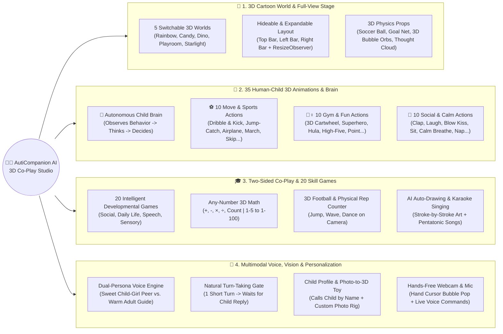
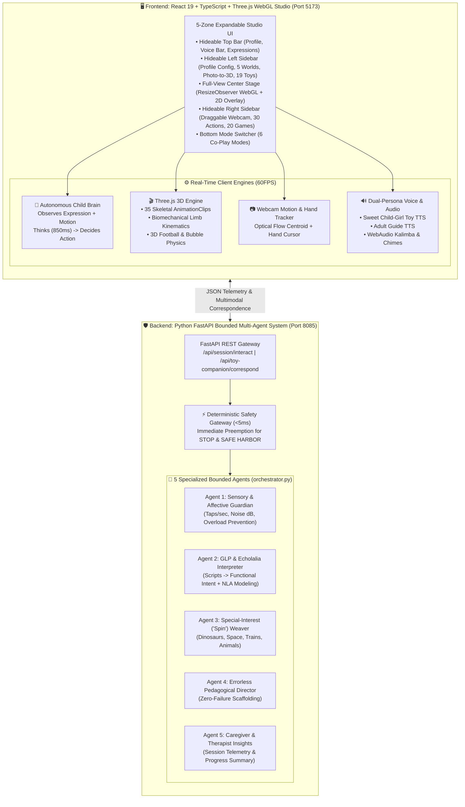
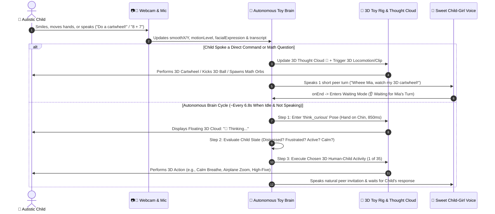
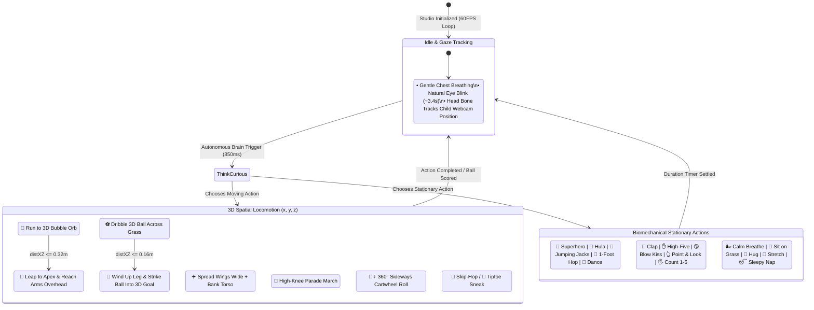

# 🧸🌈 AutiCompanion AI — 3D Cartoon Toy Co-Play Studio & Neuro-Affirming Multimodal Agentic Companion (Ages 2–11)

[](https://deepmind.google/)
[](./frontend)
[](./backend)
[](#how-autistic-children-improve-personal-social--skills-development)

> **AutiCompanion AI** is an interactive **3D Cartoon Toy Co-Play Studio** and **Neuro-Affirming Multimodal Agentic Platform** designed for autistic children aged **2 to 11**. It transforms screen time from passive, isolating consumption into **two-sided, real-world 3D peer play**—where a lifelike 3D toy companion thinks, moves, runs, jumps to catch 3D bubbles, dribbles and kicks a 3D football into a goal, draws, sings, and converses naturally in a sweet child-girl peer voice while adapting to the child's live behavior, voice, and sensory needs.

---

## 📑 Table of Contents

1. [🎬 Demo Video & Screenshots Gallery (Placeholders)](#-demo-video--screenshots-gallery)
2. [🎯 Purpose: Why AutiCompanion AI Was Built](#-purpose-why-auticompanion-ai-was-built)
3. [⚙️ How the Application Works (End-to-End)](#️-how-the-application-works-end-to-end)
4. [🌱 How Autistic Children Improve: Personal, Social & Skills Development](#-how-autistic-children-improve-personal-social--skills-development)
5. [🧠 How Gemini 4 Argon Built & Solved This Complex Solution](#-how-gemini-4-argon-built--solved-this-complex-solution)
   - [5.1 Autistic Child Needs Reasoning & Neuro-Affirming Pedagogy](#51-autistic-child-needs-reasoning--neuro-affirming-pedagogy)
   - [5.2 Multi-Layer Agentic Orchestration & Autonomous Child Brain](#52-multi-layer-agentic-orchestration--autonomous-child-brain)
   - [5.3 3D Graphics, Biomechanical Skeletal Animation & Physics Engineering](#53-3d-graphics-biomechanical-skeletal-animation--physics-engineering)
6. [🗺️ Visual Mindmaps, Solution Architecture & Workflow Diagrams](#️-visual-mindmaps-solution-architecture--workflow-diagrams)
   - [6.1 Complete Ecosystem Mindmap](#61-complete-ecosystem-mindmap)
   - [6.2 Developmental Skills & Clinical Impact Mindmap](#62-developmental-skills--clinical-impact-mindmap)
   - [6.3 End-to-End Solution Architecture Diagram](#63-end-to-end-solution-architecture-diagram)
   - [6.4 Autonomous Child Brain & Turn-Taking Workflow](#64-autonomous-child-brain--turn-taking-workflow)
   - [6.5 3D Character Locomotion, Skeletal Kinematics & Physics State Machine](#65-3d-character-locomotion-skeletal-kinematics--physics-state-machine)
7. [✨ Complete Feature List](#-complete-feature-list)
8. [🚀 Getting Started & Running the Platform](#-getting-started--running-the-platform)
9. [📂 Project Directory Structure](#-project-directory-structure)

---

## 🎬 Demo Video & Screenshots Gallery

> [!TIP]
> **Media Placeholders Ready:** Replace the placeholder paths below (`docs/media/...` and `docs/screenshots/...`) with your recorded gameplay videos and studio screenshots.

### 🎥 Official Product Demo Video

<!-- Replace the link and poster image below with your actual demo video -->
<div align="center">
  <a href="docs/media/auticompanion-full-demo.mp4">
    
  </a>
  <p><em>▶️ Click above or open <code>docs/media/auticompanion-full-demo.mp4</code> to watch the 3D Toy Character running, jumping to catch 3D bubbles, kicking 3D football goals, thinking autonomously, and co-playing with the child.</em></p>
</div>

| Demo Clip | Description | Video File / Link Placeholder |
| :--- | :--- | :--- |
| **Clip 1: Full-View 3D Cartoon Stage & Hideable Sidebars** | Collapsing Top & Left Sidebars to expand the 60FPS Three.js 3D Cartoon World to full screen. | `[Watch Clip 1](docs/media/demo-01-fullview-3d-stage.mp4)` |
| **Clip 2: Autonomous Child Brain & 35 3D Human Actions** | Toy observes child's camera behavior, enters `ThinkCurious` pose (`💭`), and autonomously performs cartwheels, airplane zooms, football kicks, and calm breathing. | `[Watch Clip 2](docs/media/demo-02-autonomous-brain-35-actions.mp4)` |
| **Clip 3: Two-Sided 3D Co-Play (Bubbles, Football & 20 Skill Games)** | Child and 3D Toy taking turns popping 3D orbs, solving any-number math, and playing the 20 developmental games. | `[Watch Clip 3](docs/media/demo-03-two-sided-coplay-games.mp4)` |
| **Clip 4: Photo-to-3D Favourite Toy & Dual-Voice Correspondence** | Uploading a child's real plush toy photo into a rigged 3D companion with sweet child-girl peer voice vs. warm adult guide voice. | `[Watch Clip 4](docs/media/demo-04-photo-to-3d-voice.mp4)` |

---

### 📸 Application Screenshots

| Full-View 3D Cartoon Co-Play Stage | Hideable & Expandable Studio Layout |
| :---: | :---: |
|  |  |
| *100% unobstructed Three.js 3D Cartoon World with 3D Rainbow, Castle, Soccer Goal, Floating 3D Orbs, and Thought Cloud.* | *5-Zone Warm Cream & Amber Studio with 1-click Hide/Expand Top Bar, Left Sidebar, and Right Sidebar.* |

| Autonomous Child Brain & 30 One-Click 3D Actions | 20 Intelligent Personal, Social & Skill Games |
| :---: | :---: |
|  |  |
| *Real-time Thought Cloud (`💭`) and 30 human-child 3D animations (`⚽ Move`, `🤸 Gym & Fun`, `💖 Social`).* | *20 structured games across Emotion Recognition, Daily Routines, Pragmatic Speech, and Sensory Calm.* |

| Two-Sided 3D Football & Jump-Catch Bubble Co-Play | Child Profile, 5 Cartoon Worlds & Photo-to-3D Toy Upload |
| :---: | :---: |
|  |  |
| *3D Toy running across the field, dribbling/kicking the 3D soccer ball into the net, and leaping to catch 3D bubbles.* | *Personalized Child Profile (Toy greets child by name), 5 switchable 3D worlds, and 19+ 3D companions.* |

---

## 🎯 Purpose: Why AutiCompanion AI Was Built

Many traditional educational apps fail autistic children for four core reasons:
1. **Harsh Sensory & Evaluative Pressure:** Loud buzzers, countdown timers, red `"X"` failure screens, and robotic adult instruction voices trigger demand avoidance and sensory overload.
2. **One-Sided "Test" Dynamics Instead of Peer Play:** Conventional apps quiz the child endlessly rather than playing *with* the child like a relatable peer friend.
3. **Static, Lifeless Avatars:** Flat 2D stickers or rigid models that only bob up and down fail to model real-world human movement, joint attention, body language, or reciprocal motor imitation.
4. **Lack of Personalization & Special-Interest ("Spin") Bonding:** Autistic children thrive when learning is anchored around their own name, their favorite physical toys, and their beloved themes (cute animals, dinosaurs, trains, space, rainbows).

**AutiCompanion AI** was built to solve these exact challenges by creating a **Neuro-Affirming 3D Cartoon Toy Co-Play Studio** where:
- The 3D toy companion acts, thinks, moves, and speaks like a **sweet, playful child friend**—never an authoritarian lecturer.
- Every game is **two-sided and cooperative**: when the child pops a 3D bubble or kicks a 3D ball, the 3D toy physically runs and jumps in 3D space to catch bubbles and kick goals *with* the child.
- The 3D toy possesses an **Autonomous Human-Child Brain** that observes the child's live facial expression, voice, and movement energy, thinks for herself (`🤔💭`), and chooses comforting, silly, or active human-child activities naturally.

---

## ⚙️ How the Application Works (End-to-End)

1. **Personalized Child Profile & Warm Studio Setup:**
   - Parents, therapists, or the child configure the **Child Profile** (Name, Age `2–11`, and Favorite Interest) in the Left Sidebar. From that moment on, the 3D Toy addresses the child by name (e.g., *"Hi Mia! Watch me dribble the 3D football and kick a goal for you!"*).
2. **Unobstructed Full-View 3D Cartoon World (Three.js WebGL at 60FPS):**
   - The center stage renders a rich, changeable 3D cartoon environment (**Rainbow Meadow**, **Candy Wonderland**, **Sunny Dino Park**, **Cozy Toy Playroom**, or **Starlight Night Garden**) complete with 3D hills, trees, castle towers, spinning windmills, a 3D soccer goal net, a 3D soccer ball with gravity/bounce physics, and floating 3D bubble orbs.
   - **Hideable & Expandable Bars:** The Top Bar, Left Sidebar, and Right Sidebar can be collapsed with a single click (`◀ Hide Left`, `🔼 Hide Top`, `▶ Hide Right`, or `⛶ Full-View 3D Stage`), triggering a `ResizeObserver` that immediately expands the 3D WebGL viewport to full screen.
3. **Dual-Persona Voice Architecture & Natural Turn-Taking:**
   - **👧 Sweet Child-Girl Peer Voice (`speakAsSweetChildGirlToy`):** Used exclusively by the 3D Toy when chatting, giggling, encouraging, and playing with the child. Crucially, the toy speaks **one short, natural turn** and then enters **Listening & Waiting Mode** (`👂 Waiting for Mia's Response`) so she never monologues over the child.
   - **👩‍🏫 Calm Adult Guide Voice (`speakAsAdultAppGuide`):** Used exclusively for app settings, camera/microphone status updates, and activity transitions.
4. **Multimodal Input (Voice + Hands-Free Webcam Motion + Touch/Pointer):**
   - **Live Speech Recognition (`webkitSpeechRecognition`):** Continuously listens (when enabled) for natural requests (*"do a cartwheel"*, *"fly like an airplane"*, *"what is 8 plus 7"*, *"draw a cat"*, *"kick the football"*, *"sing a song"*, *"candy world"*), math equations, or Gestalt phrases.
   - **Hands-Free Webcam Motion & Expression Correspondence:** Tracks the child's hand cursor (`🖐️`) in real time so the child can pop 3D bubbles or complete physical jump/wave/dance reps simply by moving in front of the camera.
5. **Autonomous Human-Child Brain & 35 Real-World 3D Animations:**
   - Every ~6.8 seconds (when `🧠 Auto-Think: ON` is active and the toy is not speaking), or whenever the child says *"decide"* / taps `💡 Let Toy Think & Decide Activity Now!`, the 3D toy places her hand on her chin (`think_curious`), updates her floating 3D Thought Cloud (`💭`), evaluates the child's current state (distressed, frustrated, high-energy moving, or calm), and autonomously executes one of **35 human-child 3D animations**.

---

## 🌱 How Autistic Children Improve: Personal, Social & Skills Development

AutiCompanion AI embeds evidence-informed, neurodiversity-affirming practices (**Naturalistic Developmental Behavioral Interventions — NDBI**, **Errorless Learning**, **Gestalt Language Processing — NLA**, and **Sensory Co-Regulation**) into playful 3D co-play:

| Developmental Area | How AutiCompanion AI Supports Growth | Built-In Games & 3D Toy Interactions |
| :--- | :--- | :--- |
| **1. Social-Emotional Reciprocity & Empathy** | Models natural peer turn-taking, shared celebration, joint attention (`👆 Point & Look`), and non-judgmental emotional recognition without forced eye-contact demands. | • **Games #1–#5:** *Happy or Sad Face Match*, *Sharing Turns Together*, *Kind Helping Friend*, *Understanding Surprise*, *Making Friends Wave*<br>• **3D Actions:** `👋 Wave Hello`, `✋ 3D High-Five`, `😘 Blow Kiss`, `👆 Point & Look`, `🙈 Peek-a-Boo`, `🤗 Cuddle Hug` |
| **2. Personal Independence & Daily Living Skills** | Breaks everyday routines into predictable, visual, low-stress 3D choices so children build confidence in self-care and daily transitions. | • **Games #6–#10:** *Healthy Yummy Snack*, *Brush Teeth & Wash Hands*, *Weather Dress-Up*, *Clean Up Toy Room*, *Safe Crossing & Traffic Lights*<br>• **3D Actions:** `🙆 Big Stretch`, `😴 Sleepy Nap`, `🧘 Sit on Grass`, `🚶 Walk Around` |
| **3. Communication, Pragmatic Speech & Gestalt Language** | Honors **echolalia**, **single words**, **gestures**, and **full sentences** equally. Translates whole-phrase scripts into communicative intent and pauses after every short turn to invite the child's reply. | • **Games #11–#15:** *Say Magic Words (Please & Thank You)*, *Ask for Help Calmly*, *Animal Voice Match*, *Yes or No Choice*, *Greeting Friends (Hello & Goodbye)*<br>• **Voice Bar & Mic:** Live voice command execution + Gestalt script recognition |
| **4. Sensory Co-Regulation & Executive Function** | Provides immediate **Errorless Learning** (wrong bubbles gently clear while the toy helps find the right one) and proactive co-regulation when the child is distressed or frustrated. | • **Games #16–#20:** *Calm Belly Breathing*, *Quiet vs. Loud Sounds*, *Pattern Next Step*, *Big vs. Little Sort*, *Bedtime Calm Routine*<br>• **3D Actions:** `🌬️ Calm Breathe`, `🤗 Cuddle Hug`, `🧘 Sit on Grass`, `🖐️ Count 1-2-3-4-5` |
| **5. Gross Motor Imitation, Bilateral Coordination & Kinesthetic Math** | Encourages whole-body movement imitation through lifelike 3D movie-style character locomotion and interactive 3D sports/gymnastics. | • **3D Sports & Gymnastics:** `⚽ Dribble & Kick Football`, `🦘 Jump & Catch Bubbles`, `🤸‍♀️ 3D Cartwheel`, `✈️ Airplane Zoom`, `🦩 1-Foot Flamingo Hop`, `🥁 Parade March`, `🤸 Jumping Jacks`<br>• **Any-Number 3D Math:** `+`, `−`, `×`, `÷`, and Counting across ranges `1–5` to `1–100` |

---

## 🧠 How Gemini 4 Argon Built & Solved This Complex Solution

Building a real-time, neuro-affirming 3D developmental studio required solving deep challenges across **clinical autism reasoning**, **multi-agent orchestration**, and **60FPS 3D WebGL skeletal animation & physics**. Here is how **Gemini 4 Argon** architected and engineered the solution:

### 5.1 Autistic Child Needs Reasoning & Neuro-Affirming Pedagogy
1. **Eliminating "Robotic Adult Over-Talking" via Dual-Persona Turn-Taking:**
   - *Challenge:* Early prototypes used a single TTS voice that continuously talked, overwhelming the child and leaving no conversational space for a response.
   - *Gemini 4 Argon Solution:* Engineered a **Dual-Persona Voice Synthesizer** ([soundEffects.ts](file:///c:/Users/mrmoh/Desktop/austicapp/frontend/src/utils/soundEffects.ts)) that separates the **3D Toy's Sweet Child-Girl Peer Voice** (high-pitched, warm, playful cartoon cadence) from the **Adult App Guide Voice** (calm instructional voice for settings). Furthermore, Gemini 4 Argon implemented a strict **Turn-Taking Gate** (`waitingForChildReply` + `lastSpeechEndTimeRef`) so the toy speaks one concise, affectionate sentence using the child's name and then waits silently for the child to speak, move, or tap.
2. **Errorless Two-Sided Cooperative Play:**
   - *Challenge:* Autistic learners often experience anxiety when faced with pass/fail quizzes or when playing alone on screen.
   - *Gemini 4 Argon Solution:* Designed **Two-Sided 3D Co-Play**. In every bubble, math, and developmental skill game, the 3D Toy actively participates alongside the child—running across the 3D stage and leaping into the air to clear distractor bubbles with her own 3D hands (`Toy 3D Catch` counter) while cheering the child on toward the target answer.
3. **Affective & Sensory Co-Regulation Without Invasive Surveillance:**
   - *Challenge:* Children may become distressed (`crying_distressed`), frustrated (`frowning_frustrated`), or hyper-active (`motionLevel > 3.2`).
   - *Gemini 4 Argon Solution:* Built a behavior-sensitive mapping where distress immediately shifts the toy's autonomous brain into **Soothing Co-Regulation** (`calm_breathe`, `hug`, `blow_kiss`), frustration triggers **Low-Demand Silly Play** (`tiptoe_sneak`, `hula_wiggle`, `sit_relax`), and high camera motion triggers **Reciprocal Gross-Motor Play** (`jumping_jacks`, `cartwheel_flip`, `airplane_zoom`, `kick_football`).

### 5.2 Multi-Layer Agentic Orchestration & Autonomous Child Brain
1. **Frontend Autonomous Human-Child Brain (`triggerAutonomousChildBrainDecisionNow`):**
   - *Challenge:* A static character that only reacts when clicked feels mechanical rather than like a living cartoon playmate.
   - *Gemini 4 Argon Solution:* Engineered an **Autonomous Human-Child Decision Engine** ([FullCameraARExperience.tsx](file:///c:/Users/mrmoh/Desktop/austicapp/frontend/src/components/FullCameraARExperience.tsx#L2700-L2965)) that runs a two-stage cognitive cycle:
     - **Stage 1 (Visible Thinking):** The 3D toy enters the `think_curious` skeletal pose (right hand on chin, head tilted) for `850ms` and displays a real-time 3D Thought Cloud Sprite (`💭 Thinking...`) above her head in Three.js space.
     - **Stage 2 (Contextual Decision Execution):** Based on live webcam motion energy, facial expression state, and recent history, the brain selects from **35 human-child 3D activities**, updates the 3D Thought Cloud with her internal reasoning, and executes the full 3D locomotion + voice turn.
2. **Backend Bounded Multi-Agent Architecture (`orchestrator.py`):**
   - *Challenge:* Unconstrained LLM outputs can violate clinical safety, break motor-plan consistency, or introduce latency during a meltdown.
   - *Gemini 4 Argon Solution:* Architected a **5-Agent Bounded Orchestrator** ([orchestrator.py](file:///c:/Users/mrmoh/Desktop/austicapp/backend/agents/orchestrator.py)) with a **`<5ms` Deterministic Safety Preemption Gateway** (`STOP` and `SAFE HARBOR` bypass all LLM latency), a **Sensory Guardian Agent**, a **GLP/Echolalia Interpreter Agent**, a **Special-Interest ("Spin") Pedagogical Weaver**, and a **Caregiver Insights Agent**.

### 5.3 3D Graphics, Biomechanical Skeletal Animation & Physics Engineering
1. **Unobstructed Full-View 3D Stage & Dynamic `ResizeObserver` Layout:**
   - *Challenge:* Floating UI banners over the canvas blocked the 3D character, and hiding sidebars didn't automatically resize the WebGL projection matrix.
   - *Gemini 4 Argon Solution:* Relocated all HUD controls, speech bubbles, and game cards cleanly into the Left and Right Sidebars, made the **Top Bar, Left Sidebar, and Right Sidebar hideable and expandable**, and attached a `ResizeObserver` directly to the Three.js mount so collapsing any bar seamlessly expands the 3D viewport to full view.
2. **Seamless Skinned Plush Rigs + 35 Skeletal `AnimationClip`s + 60FPS Bone Kinematics:**
   - *Challenge:* Early 3D primitives had visible joint seams and only 2–3 basic motions (simple bobbing or spinning) instead of real human-child movement.
   - *Gemini 4 Argon Solution:* Built a hybrid **Skeletal `AnimationMixer` + Real-Time Biomechanical Limb Kinematics Engine** ([threeToyBuilder.ts](file:///c:/Users/mrmoh/Desktop/austicapp/frontend/src/services/threeToyBuilder.ts), [FullCameraARExperience.tsx](file:///c:/Users/mrmoh/Desktop/austicapp/frontend/src/components/FullCameraARExperience.tsx#L903-L1620)) featuring:
     - **35 distinct `AnimationClip`s** driving hips, spine, head, jaw, upper arms, forearms, thighs, and shins.
     - **True 3D Spatial Locomotion State Machine:** The toy physically walks, runs, skips, tiptoes, marches, cartwheels, and airplane-zooms across `(x, y, z)` coordinates on the 3D stage, leaning into turns and tracking targets with her head bone.
     - **Real-World 3D Football & Jump-Catch Physics:** Added a 3D soccer ball with gravity (`-6.8 m/s²`), grass restitution bounce, spin, and 3D Goal Net collision detection (`x: [1.84, 2.48]`), plus mid-air apex hand-reach kinematics when jumping to pop 3D bubbles.

---

## 🗺️ Visual Mindmaps, Solution Architecture & Workflow Diagrams

### 6.1 Complete Ecosystem Mindmap



---

### 6.2 Developmental Skills & Clinical Impact Mindmap


---

### 6.3 End-to-End Solution Architecture Diagram



---

### 6.4 Autonomous Child Brain & Turn-Taking Workflow



---

### 6.5 3D Character Locomotion, Skeletal Kinematics & Physics State Machine



---

## ✨ Complete Feature List

### 1. 🏞️ Full-View 3D Cartoon Studio & Hideable/Expandable Interface
- **100% Unobstructed Central 3D Stage:** All UI cards, speech readouts, and controls live cleanly inside sidebars so the 3D world and 3D character are never covered.
- **Hideable & Expandable Top Bar, Left Sidebar, and Right Sidebar:**
  - Instant 1-click collapse buttons (`◀ Hide Left Bar`, `🔼 Hide Top`, `▶ Hide Right Bar`, and `⛶ Full-View 3D Stage`).
  - Floating edge tabs (`🔽 Expand Top Bar`, `▶ Expand Left Bar`, `◀ Expand Right Bar`, `🪟 Restore Top & Left Bars`) appear on the edges of the central stage whenever panels are hidden.
  - **Live `ResizeObserver` WebGL Scaling:** The Three.js camera aspect ratio and WebGL canvas automatically resize the instant any sidebar is hidden or expanded.
- **5 Switchable 3D Cartoon Artwork Environments:**
  1. 🌈 **Rainbow Meadow** (Sunny sky, 3D rainbow arch, pastel castle, rolling hills, wildflowers)
  2. 🍭 **Candy Wonderland** (Pink cotton-candy sky, giant 3D spiral lollipops, peppermint hills)
  3. 🦕 **Sunny Dino Park** (Golden jungle sky, palm trees, volcano backdrop, prehistoric ferns)
  4. 🧸 **Cozy Toy Playroom** (Warm wood/carpet floor, giant 3D `A-B-C` blocks, starry window)
  5. 🌙 **Starlight Night Garden** (Deep twilight sky, glowing 3D crescent moon, fireflies, calm lavender hills)

### 2. 🤸 35 Real-World Human-Child 3D Animations & Autonomous Brain
- **Autonomous Human-Child Brain (`🧠 Auto-Think: ON/OFF`):**
  - Observes the child's live facial expression (`smiling_happy`, `crying_distressed`, `surprised_curious`, `frowning_frustrated`) and webcam movement energy (`motionLevel`).
  - Enters a visible `think_curious` pose (hand on chin, head tilted) and updates a **3D Floating Thought Cloud Sprite (`💭`)** above the toy's head before autonomously choosing the most helpful child activity.
- **30 One-Click & Voice-Activated Human-Child 3D Activities** (plus 5 core reactive clips = **35 total 3D animations**), organized into 3 filterable categories:
  - **⚽ Move & Sports (10):** `⚽ Dribble & Kick`, `🦘 Jump & Catch`, `✈️ Airplane Zoom`, `🥁 Parade March`, `🤸 Jumping Jacks`, `🐰 Skip & Hop`, `🦩 1-Foot Hop`, `🚶 Walk Around`, `🏃 Fast Run`, `🤫 Tiptoe Sneak`.
  - **🤸 Gym & Fun Play (10):** `🤸‍♀️ 3D Cartwheel`, `🦸 Superhero Pose`, `🌺 Hula Wiggle`, `💃 3D Dance`, `🙈 Peek-a-Boo`, `✋ 3D High-Five`, `🙇 Ta-Da! Bow`, `👆 Point & Look`, `🖐️ Count 1-2-3-4-5`, `🤔 Think Curious`.
  - **💖 Social, Emotion & Calm (10):** `👏 Clap Hands`, `🙌 Cheer Hurrah`, `🤭 Laugh & Giggle`, `😘 Blow Kiss`, `👋 Wave Hello`, `🤗 Cuddle Hug`, `🧘 Sit on Grass`, `🌬️ Calm Breathe`, `🙆 Big Stretch`, `😴 Sleepy Nap`.

### 3. 🎓 20 Intelligent Personal, Social & Developmental Skill Games
- Organized across **4 Clinical Developmental Domains** with filter tabs and 1-click or 3D bubble-pop answers:
  - **💖 Social-Emotional & Empathy (Games 1–5):** *Happy or Sad Face Match*, *Sharing Turns Together*, *Kind Helping Friend*, *Understanding Surprise*, *Making Friends Wave*.
  - **🏡 Daily Living & Personal Independence (Games 6–10):** *Healthy Yummy Snack*, *Brush Teeth & Wash Hands*, *Weather Dress-Up*, *Clean Up Toy Room*, *Safe Crossing & Traffic Lights*.
  - **🗣️ Communication & Pragmatic Speech (Games 11–15):** *Say Magic Words (Please & Thank You)*, *Ask for Help Calmly*, *Animal Voice Match*, *Yes or No Choice*, *Greeting Friends (Hello & Goodbye)*.
  - **🧘 Sensory Regulation & Executive Thinking (Games 16–20):** *Calm Belly Breathing*, *Quiet vs. Loud Sounds*, *Pattern Next Step*, *Big vs. Little Sort*, *Bedtime Calm Routine*.

### 4. ⚽ Two-Sided 3D Co-Play, Any-Number Math & Creative Studio
- **3D Football Physics & Goal Net:** Real-time 3D soccer ball with gravity, grass bounce, spin, dribbling at the toy's feet, and goal net collision detection with celebratory particle bursts.
- **3D Jump-Catch Bubble Co-Play:** Both the child (via touch or webcam hand cursor `🖐️`) and the 3D Toy (by physically running and leaping in 3D space) catch and pop floating 3D orbs with a live scoreboard (`👧 Child Pops` vs. `🦘 Toy 3D Catch`).
- **Any-Number 3D Math Engine:** Supports Addition (`+`), Subtraction (`−`), Multiplication (`×`), Division (`÷`), and Counting (`count`) across number ranges `1–5`, `1–10`, `1–20`, `1–100`, plus custom spoken or typed math equations (e.g., *"What is 12 + 15?"*).
- **AI Toy Stroke-by-Stroke Auto-Drawing & 3D Brush Canvas:** Ask the toy to draw a `🐱 Cat`, `🏎️ Car`, `🌈 Rainbow`, `🌸 Flower`, `🏠 House`, or `💖 Heart` and watch it animate stroke-by-stroke with musical notes, or draw together on the canvas.
- **Sing & Dance Karaoke Mode:** Built-in favourite children's songs with synchronized WebAudio melodies, lyrics, jaw lip-sync, and 3D dance motion.

### 5. 🧸 19 Pre-Built 3D Companions + Photo-to-3D Favourite Toy Upload
- **19 Pre-Built 3D Toys** across **Plush Friends**, **Flying Birds**, **Toy Vehicles**, and **Expressive Robots** (combining seamless procedural skinned plush rigs and studio `.glb` models with `RoomEnvironment` PBR lighting).
- **Photo ➔ Live 3D Toy Converter:** Upload any photo of a child's real-world favourite toy; the app automatically removes the background, extracts dominant colours/textures, and binds it onto a fully rigged 3D companion.
- **Dockable, Drag-Movable & Drag-Resizable Webcam Preview:** Located in the Right Sidebar with a 1-click `🙈 Hide / 🎥 Show` toggle for sensory-sensitive moments.

---

## 🚀 Getting Started & Running the Platform

### Prerequisites
- **Node.js** `v18+` and `npm`
- **Python** `3.10+` and `pip`

### 1. Start the Python FastAPI Multi-Agent Backend
```powershell
cd backend
pip install -r requirements.txt
python -m uvicorn main:app --host 127.0.0.1 --port 8085 --reload
```
- The backend API and interactive Swagger documentation will be available at `http://127.0.0.1:8085/docs`.

### 2. Start the React + Three.js 3D Studio Frontend
```powershell
cd frontend
npm install
npm run dev
```
- Open `http://localhost:5173` in Chrome or Edge (recommended for WebGL, Web Speech API, and Webcam support).

### 3. Production Build Verification
```powershell
cd frontend
npm run build
```

---

## 📂 Project Directory Structure

```text
austicapp/
├── backend/
│   ├── agents.py                    # 5-Agent Bounded Orchestrator (Sensory, GLP, Spin, Pedagogy, Caregiver)
│   ├── ar_agent.py                  # Multimodal 3D Toy Correspondence & Child Behavior Reasoning Agent
│   ├── policy_gateway.py            # Deterministic Safety Gateway (<5ms STOP & SAFE HARBOR Preemption)
│   ├── schemas.py                   # Pydantic schemas for Child Profile, Telemetry & Agent State
│   ├── ar_schemas.py                # Schemas for 3D Toy Co-Play & Multimodal Correspondence
│   ├── main.py                      # FastAPI endpoints (/api/session/interact, /api/toy-companion/correspond)
│   ├── test_agents.py               # Automated multi-agent & safety gateway verification suite
│   └── requirements.txt
├── docs/
│   ├── media/                       # Placeholders for full product demo video & feature clips
│   └── screenshots/                 # Placeholders for 3D Cartoon Stage & Studio UI screenshots
├── frontend/
│   ├── public/
│   │   ├── draco/                   # Draco 3D mesh compression decoders
│   │   └── models/                  # Studio GLB 3D assets (Fox, Yeti, Parrot, Flamingo, Car, Truck, Robot...)
│   ├── src/
│   │   ├── components/
│   │   │   ├── FullCameraARExperience.tsx  # Main 3D Cartoon Co-Play Studio, Autonomous Brain & 60FPS Loop
│   │   │   ├── FixedCoreAACDock.tsx        # Immutable Motor-Plan Fitzgerald Key AAC Dock
│   │   │   ├── SafeHarborView.tsx          # Zero-Demand Co-Regulation Safe Harbor
│   │   │   ├── AACAndGestaltStudio.tsx     # Gestalt Language Processing & Echolalia Studio
│   │   │   ├── SpecialInterestLearningLab.tsx # Special-Interest ("Spin") Errorless Learning Lab
│   │   │   ├── CreativeCoPlayStudio.tsx    # Co-Play Music & Creative Sandbox
│   │   │   └── CaregiverClinicianPortal.tsx # Adult Telemetry & Clinical Controls
│   │   ├── services/
│   │   │   ├── threeToyBuilder.ts          # Three.js Rig Builder, 35 Skeletal Clips, 5 Cartoon Worlds & 3D Props
│   │   │   ├── intelligentGamesCatalog.ts  # 20 Personal, Social & Developmental Skill Games Catalog
│   │   │   ├── soundAndSpeech.ts           # Dual-Persona Voice Engine (Child-Girl Peer vs. Adult Guide) & WebAudio
│   │   │   ├── toyActivitiesAndDrawing.ts  # Stroke-by-Stroke AI Toy Auto-Drawing & Song Melodies
│   │   │   └── agentClient.ts              # Frontend-to-FastAPI Multi-Agent Client
│   │   ├── App.tsx
│   │   └── App.css                         # Warm Cream/Amber 5-Zone Studio Styles & Expandable Edge Tabs
│   └── package.json
├── start-app.ps1                    # One-click PowerShell launcher for Backend + Frontend
└── README.md
```
