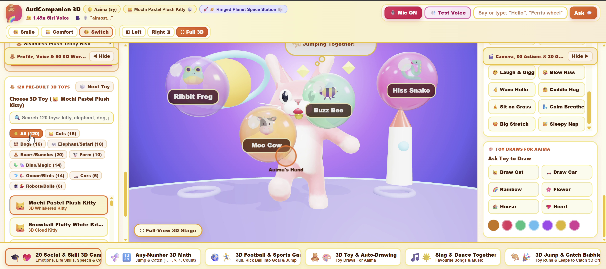
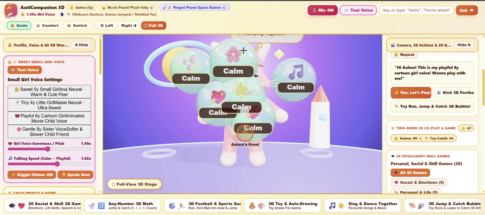
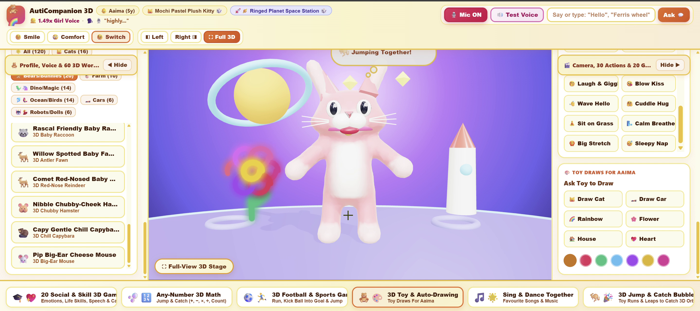
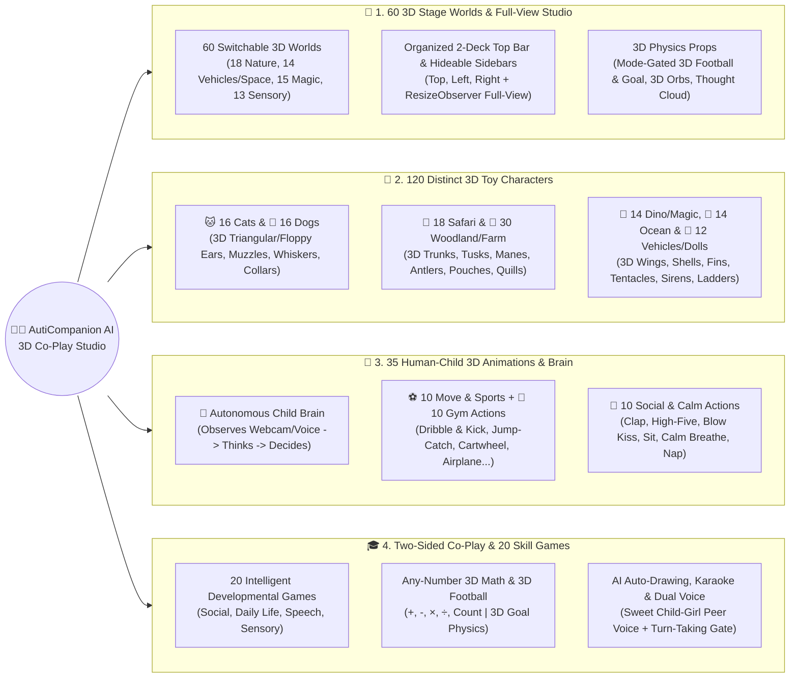
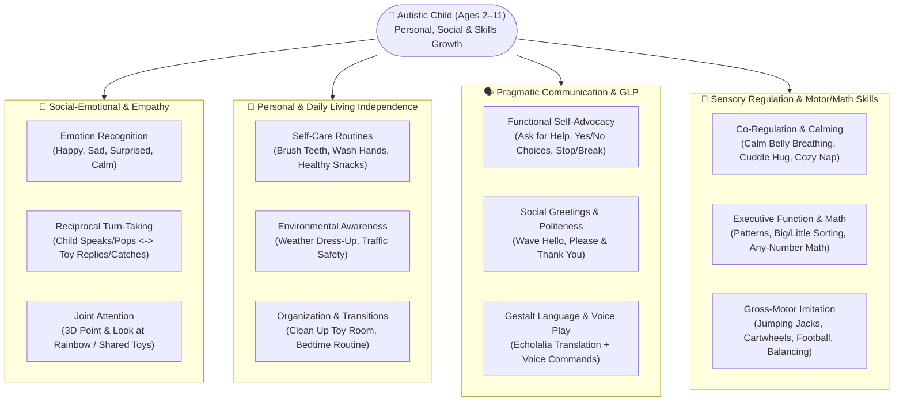
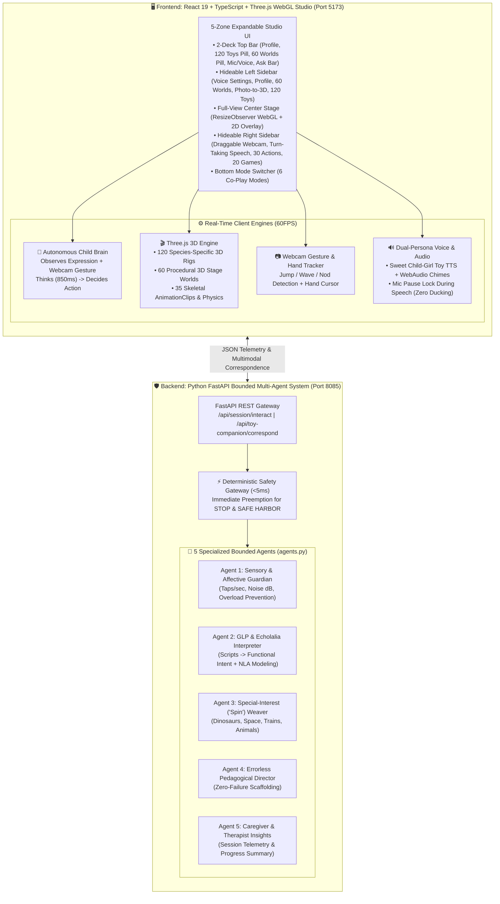

# 🧸🌈 AutiCompanion AI — 3D Cartoon Toy Co-Play Studio & Neuro-Affirming Multimodal Agentic Companion (Ages 2–11)

[](https://youtu.be/vL05-y37-_8)
[-120%203D%20Toys%20%7C%2060%20Worlds%20%7C%202--Way%20Co--Play-ec4899?style=for-the-badge&logo=github&logoColor=white)](./docs/media/new-autistic-child-coplay-demo.mp4)
[](https://deepmind.google/)
[](./frontend)
[](./backend)
[](#how-autistic-children-improve-personal-social--skills-development)

> **AutiCompanion AI** is an interactive **3D Cartoon Toy Co-Play Studio** and **Neuro-Affirming Multimodal Agentic Platform** designed for autistic children aged **2 to 11**. It transforms screen time from passive, isolating consumption into **two-sided, real-world 3D peer play**—where **120 distinct 3D toy companions** across **60 sensory-friendly 3D stage worlds** think, move, run, jump to catch 3D bubbles, dribble and kick a 3D football into a goal, draw, sing, and converse naturally in a **Sweet Small Girl Peer Voice** (`en-US-AnaNeural` / `en-GB-MaisieNeural`) while listening and responding to the child's live webcam gestures, facial expressions, and voice.

---

## 📑 Table of Contents

1. [🎬 Official Demo Videos (Video 1 & New Update Video 2) & Live Studio Gallery](#-official-demo-videos-video-1--new-update-video-2--live-studio-gallery)
2. [🆕 Latest Major Release Highlights (120 3D Toys, 60 3D Worlds & True Two-Way Co-Play)](#-latest-major-release-highlights-120-3d-toys-60-3d-worlds--true-two-way-co-play)
3. [🎯 Purpose: Why AutiCompanion AI Was Built](#-purpose-why-auticompanion-ai-was-built)
4. [⚙️ How Each Feature & Working Activity Operates (Step-by-Step Guide)](#️-how-each-feature--working-activity-operates-step-by-step-guide)
5. [🌱 How Autistic Children Improve: Personal, Social & Skills Development](#-how-autistic-children-improve-personal-social--skills-development)
6. [🧠 How Gemini 4 Argon Built & Solved This Complex Solution](#-how-gemini-4-argon-built--solved-this-complex-solution)
   - [6.1 Autistic Child Needs Reasoning & Neuro-Affirming Pedagogy](#61-autistic-child-needs-reasoning--neuro-affirming-pedagogy)
   - [6.2 Multi-Layer Agentic Orchestration & Autonomous Child Brain](#62-multi-layer-agentic-orchestration--autonomous-child-brain)
   - [6.3 3D Species Anatomy, Biomechanical Skeletal Animation & Physics Engineering](#63-3d-species-anatomy-biomechanical-skeletal-animation--physics-engineering)
7. [🗺️ Visual Mindmaps, Solution Architecture & Workflow Diagrams](#️-visual-mindmaps-solution-architecture--workflow-diagrams)
8. [✨ Complete Feature & Activity Reference](#-complete-feature--activity-reference)
9. [🚀 Getting Started & Running the Platform](#-getting-started--running-the-platform)
10. [📂 Project Directory Structure](#-project-directory-structure)

---

## 🎬 Official Demo Videos (Video 1 & New Update Video 2) & Live Studio Gallery

### 🎥 Video 2 (NEW UPDATE): 120 3D Toy Characters, 60 3D Stage Worlds & Two-Sided Webcam/Voice Co-Play

<div align="center">
  <a href="./docs/media/new-autistic-child-coplay-demo.mp4" target="_blank">
    
  </a>
  <p>
    <a href="./docs/media/new-autistic-child-coplay-demo.mp4" target="_blank">
      
    </a>
  </p>
  <p><em>🔗 <strong>Direct Repository Video Link:</strong> <a href="./docs/media/new-autistic-child-coplay-demo.mp4"><code>docs/media/new-autistic-child-coplay-demo.mp4</code></a> — Demonstrates the newly expanded <strong>120 3D Toy Companions</strong> (such as <strong>Mochi Pastel Plush Kitty</strong> with 3D triangular ears, whiskers, and bell), <strong>60 Creative 3D Stage Worlds</strong> (Rainbow Meadow, Ringed Planet Space Station, Sensory Rooms, Vehicles & Magic), <strong>Two-Sided Webcam Gesture & Voice Sync</strong> (<code>[Webcam Gesture: Aaima Jumped / Nodded Yes]</code>), <strong>20 Skill Games</strong>, and <strong>3D Toy Auto-Drawing</strong>!</em></p>
</div>

---

### 🎥 Video 1: Original Full 3D Studio Demo on YouTube

<div align="center">
  <a href="https://youtu.be/vL05-y37-_8" target="_blank">
    
  </a>
  <p>
    <a href="https://youtu.be/vL05-y37-_8" target="_blank">
      
    </a>
  </p>
  <p><em>🔗 <strong>Direct YouTube Link:</strong> <a href="https://youtu.be/vL05-y37-_8">https://youtu.be/vL05-y37-_8</a> — Watch the 3D Toy Companion running, jumping in 3D space to catch bubbles, kicking 3D football goals, thinking autonomously, speaking in a sweet small girl peer voice, and co-playing with the child via live webcam tracking.</em></p>
</div>

---

### 📸 Visual Walkthrough of Every Feature & Working Activity

#### 1. Two-Sided Webcam Gesture Sync, 60 3D Stage Worlds & Distinct 3D Kitty Character (`child new.png`)

> **What Visitors See in Action:**
> - **Clean 2-Deck Top Studio Header:** Displays the active child profile (`👶 Aaima (5y)`), 1-click 3D Toy switcher (`🐱 Mochi Pastel Plush Kitty 🎲`), 1-click 3D World switcher (`🌈🌸 Rainbow Meadow 🎲`), live webcam/voice telemetry (`[Webcam Gesture: Aaima Jumped / Nodded Yes]`), `🎙️ Mic ON`, `🔊 Test Voice`, and natural language `Ask 💬` input.
> - **60 3D Stage Worlds Browser (Left Sidebar):** Filterable across `🌟 All (60)`, `🌿 Nature (18)`, `🚂 Vehicles (14)`, `🍭 Magic (15)`, and `🫧 Sensory (13)` with a `🎲 Next World` instant cycler.
> - **Two-Sided Webcam Co-Play (Center & Right Sidebar):** When the user jumps or moves in `🎥 AAIMA'S CAMERA` (`✨ 😊 Aaima Moving — Toy Synced!`), the 3D Mochi Kitty thinks `🦘 Jumping Together!` in her 3D Thought Cloud and leaps alongside `🖐️ Aaima's Hand` to catch floating 3D bubbles!

---

#### 2. 120 Pre-Built 3D Toy Characters, Animal Voice Match & AI Toy Auto-Drawing

> **What Visitors See in Action:**
> - **120 Pre-Built 3D Toys Library (Left Sidebar):** Searchable (`🔍 Search 120 toys: kitty, elephant, dog...`) and organized into **10 category tabs**: `🌟 All (120)`, `🐱 Cats (16)`, `🐶 Dogs (16)`, `🐘 Elephant/Safari (18)`, `🧸 Bears/Bunnies (20)`, `🐮 Farm (10)`, `🦕🦄 Dino/Magic (14)`, `🐬🐧 Ocean/Birds (14)`, `🚓 Cars (6)`, and `🤖🧚 Robots/Dolls (6)`.
> - **3D Space Station World (`🪐🚀 Ringed Planet Space Station`):** Custom 3D ringed planet, glowing stars, and 3D rocket ship behind the 3D character.
> - **Interactive Speech & Sound Bubble Game:** Floating 3D glossy orbs (`🐸 Ribbit Frog`, `🐮 Moo Cow`, `🐝 Buzz Bee`, `🐍 Hiss Snake`) tracked by `🖐️ Aaima's Hand`.
> - **AI Toy Stroke-by-Stroke Auto-Drawing (Right Sidebar):** 1-click buttons (`🐱 Draw Cat`, `🏎️ Draw Car`, `🌈 Rainbow`, `🌸 Flower`, `🏠 House`, `💖 Heart`) where the 3D toy draws colorful artwork directly on the stage.

---

#### 3. Space Station Co-Play Scoreboard, Turn-Taking Speech & 3D Rainbow Flower Art
| Space Station Co-Play & Turn-Taking (`new-video-feature-03.png`) | Toy Auto-Drawing 3D Flower & 120 Toy Browser (`new-video-feature-05.png`) |
| :---: | :---: |
|  |  |
| *Live Two-Sided Co-Play Scoreboard (`⭐ 47` \| `👧 Aaima: 90 👏` \| `🦘 Toy Catch: 44`), Sweet 6y Cartoon Girl Voice settings (`1.49x`), and 20 Intelligent Skill Games.* | *3D Mochi Kitty drawing a glowing 3D Rainbow Flower in the Space Station while browsing Raccoon, Spotted Fawn, Red-Nosed Reindeer, Hamster, Capybara & Mouse 3D toys.* |

---

#### 4. Classic 3D Teddy Co-Play, 20 Social Games & 100% Unobstructed Full-View 3D Stage
| Two-Sided Hand Tracking & Voice Settings | 20 Social Games & 3D Thought Cloud | Full-View 3D Stage (All Bars Hidden) |
| :---: | :---: | :---: |
|  |  |  |

---

## 🆕 Latest Major Release Highlights (120 3D Toys, 60 3D Worlds & True Two-Way Co-Play)

1. **🧸 120 Distinct 3D Toy Characters with Species-Specific 3D Anatomy & Coat Markings:**
   - Every 3D character renders with a **unique 3D body silhouette, exterior 3D anatomical parts, and procedural 3D surface patterns** (stripes, spots, patches, facial masks, and tuxedo bibs)—never a generic color swap:
     - **🐱 16 Kitties, Cats & Big Cats:** Sleek feline torso, tall pointed 3D triangular ears with pink inner shells, twin plump white `ω` whisker muzzle puffs, pink 3D triangle nose, 6 long exterior 3D whiskers, high S-curved feline tail, pink collar + golden bell (or red 3D bowtie on Tuxedo Kitty), plus tabby/tiger stripes and calico/leopard spots.
     - **🐶 16 Baby Dogs & Puppies:** Sculpted 3D canine muzzle box, big glossy black 3D dog nose, breed-specific **long hanging 3D floppy ears** (Golden Puppy, Dalmatian, Beagle, Pug, Poodle, Dachshund, Bernese) or **tall perky ears** (Corgi, Husky, Frenchie, Shiba, Puppy), happy pink 3D tongue on the articulated jaw bone, Poodle pom-pom crown, Dalmatian spots, and red collar + golden tag.
     - **🐘 18 Baby Elephants & Safari Friends:** Chubby elephant body, giant exterior 3D scalloped fan ears (`x = ±0.54`), articulated 5-segment S-curved 3D elephant trunk (`z = +0.94`), and 2 curved ivory 3D tusks; **Baby Lion** with a 14-petal 3D mane ring; **Baby Giraffe** with elongated neck, spots, and ossicone horns; **Zebra** with black/white stripes; **Kangaroo** with exterior 3D belly pouch & baby Joey peeking out; **Hippo & Rhino** with wide barrel snouts & nose horn.
     - **🧸 20 Bears, Pandas, Bunnies, Koalas, Sloths, Hedgehogs, Raccoons & Deer:** Giant Panda black/white limb & eye patches, tall Bunny ears, 20 exterior 3D Hedgehog back quills, giant Squirrel/Red Panda plume tails, Raccoon 3D bandit mask, and multi-branched Deer/Reindeer antlers (with glowing red nose on Comet Reindeer).
     - **🦕🦄🐬🚓 40+ Farm Animals, Dinosaurs, Dragons, Unicorns, Ocean Friends, Birds & Rescue Vehicles:** Triceratops crown shield frill & 3 horns, Stegosaurus dorsal plates, 1.4m-span Dragon/Pegasus/Fairy 3D wings, domed emerald Sea Turtle carapace shell, Dolphin/Whale/Narwhal flippers & dorsal fin, 6 splayed Octopus tentacles, 6 crimson Axolotl gill branches, Frog top-mounted eye domes, Penguin red winter scarf & beak, Superhero flowing red cape & mask, plus Police Cruiser lightbar, Fire Engine roof ladder & beacon, and School Bus roof sign & `STOP` arm.
2. **🎡 60 Sensory-Friendly 3D Stage Environments Across 4 Categories:**
   - **🌿 Nature & Animals (18 Worlds):** *Rainbow Meadow*, *Sunny Dino Park*, *Butterfly Flower Garden*, *Tropical Dolphin Lagoon*, *Bamboo Panda Forest*, *Snowy Penguin Iceberg*, *Autumn Acorn Woods*, *Bunny Carrot Patch*, *Koi Fish Zen Pond*, *Sunflower Bee Field*, *Safari Sunset Savanna*, *Misty Waterfall Oasis*, *Cherry Blossom Park*, *Desert Cactus Canyon*, *Alpine Snowy Peaks*, *Meadow Picnic Blanket*, *Glowing Mushroom Grove*, *Enchanted Treehouse*.
   - **🚂 Vehicles, Space & Builders (14 Worlds):** *Steam Train Valley*, *Ringed Planet Space Station*, *3D Voxel Block World*, *Toy Car Race Track*, *Pirate Treasure Cove*, *Hot Air Balloon Sky*, *Firefighter Rescue Station*, *Airport Runway & Jets*, *Construction Crane Site*, *Harbor Tugboat Dock*, *Lunar Moon Rover Base*, *Submarine Deep Sea Trench*, *Farm Tractor Barn*, *Robot Invention Lab*.
   - **🍭 Magic, Fantasy & Sweet (15 Worlds):** *Candy Wonderland*, *Amusement Ferris Park*, *Bouncy Trampoline Castle*, *Dragon Crystal Cavern*, *Mermaid Pearl Palace*, *Unicorn Cloud Kingdom*, *Gingerbread Cookie Village*, *Ice Cream Sundae Island*, *Wizard Potion Library*, *Fairy Lantern Woods*, *Floating Sky Islands*, *Giant Storybook Castle*, *Teddy Bear Tea Party*, *Rainbow Waterpark Slide*, *Pirate Sky Airship*.
   - **🫧 Sensory, Calm & Indoor (13 Worlds):** *Cozy Toy Playroom*, *Starlight Night Garden*, *Sensory Lava Lamp Room*, *Ocean Coral Aquarium*, *Musical Xylophone Stage*, *Giant Bubble Dome*, *Soft Pillow Fort Tent*, *Fiber Optic Sensory Cave*, *Warm Campfire Night*, *Northern Lights Igloo*, *Art & Paint easel Studio*, *Calm Zen Sand Garden*, *Sensory Ball Pit Gym*.
3. **🤝 True Two-Sided Cooperative Turn-Taking (Voice + Webcam Gestures + Expressions):**
   - **Never Monologues Unprompted:** The 3D Toy speaks **one concise, affectionate turn** in her Sweet Small Girl Voice and then automatically pauses (`👂 Waiting for Child's Turn`), resuming the microphone so the child can answer at their own pace.
   - **Live Webcam Gesture & Expression Sync:** Detects child waves, jumps, head nods, smiles, and distress on camera, mirroring the child's actions in 3D space and responding empathetically.
4. **⚽ Dedicated 3D Football & Sports Mode + Organized 2-Deck Top Bar:**
   - The 3D Soccer Ball and 3D Goal Net appear **exclusively** when playing **3D Football & Sports Game** mode (or when the child asks to kick the ball), keeping all other 60 stage worlds clean and uncluttered.

---

## 🎯 Purpose: Why AutiCompanion AI Was Built

Many traditional educational apps fail autistic children for four core reasons:
1. **Harsh Sensory & Evaluative Pressure:** Loud buzzers, countdown timers, red `"X"` failure screens, and robotic adult instruction voices trigger demand avoidance and sensory overload.
2. **One-Sided "Test" Dynamics Instead of Peer Play:** Conventional apps quiz the child endlessly rather than playing *with* the child like a relatable peer friend.
3. **Static, Lifeless Avatars:** Flat 2D stickers or rigid models that only bob up and down fail to model real-world human movement, joint attention, body language, or reciprocal motor imitation.
4. **Lack of Personalization & Special-Interest ("Spin") Bonding:** Autistic children thrive when learning is anchored around their own name, their favorite physical toys, and their beloved themes (kitties, puppies, baby elephants, dinosaurs, trains, space, rainbows).

**AutiCompanion AI** solves these exact challenges by creating a **Neuro-Affirming 3D Cartoon Toy Co-Play Studio** where:
- The 3D toy companion acts, thinks, moves, and speaks like a **sweet, playful child friend**—never an authoritarian lecturer.
- Every activity is **two-sided and cooperative**: when the child pops a 3D bubble, jumps on camera, or asks a question, the 3D toy physically runs, jumps, catches bubbles, kicks goals, draws, or sings *with* the child.

---

## ⚙️ How Each Feature & Working Activity Operates (Step-by-Step Guide)

Below is a complete walkthrough of how every interactive feature and working activity in **AutiCompanion AI** operates for the child, parent, or therapist:

### 1. 🧸 Choosing or Uploading Any of the 120+ 3D Toy Companions
- **How It Works:**
  1. In the **Left Sidebar (`🧸 120 PRE-BUILT 3D TOYS`)** or the **Top Header (`🎲` Toy Pill)**, type in the search bar (e.g., `"kitty"`, `"elephant"`, `"corgi"`, `"dragon"`, `"turtle"`), select any of the **10 category tabs**, or click **`🎲 Next Toy`**.
  2. You can also switch toys hands-free by **speaking or typing** in the Top Ask Bar (e.g., *"change to baby elephant"*, *"be a kitty"*, *"show puppy"*).
  3. **Photo-to-3D Favourite Toy Upload:** Click **`📸 Upload Favourite Toy Photo`** in the Left Sidebar to upload a photo of the child's real-life toy; the engine removes the background, extracts dominant colors, and wraps the texture onto a live 3D skeletal rig.

### 2. 🎡 Exploring the 60 Creative 3D Stage Environments
- **How It Works:**
  1. In the **Left Sidebar (`🎡 3D STAGE WORLDS (60)`)**, filter by **`🌟 All (60)`**, **`🌿 Nature (18)`**, **`🚂 Vehicles (14)`**, **`🍭 Magic (15)`**, or **`🫧 Sensory (13)`**, or click **`🎲 Next World`**.
  2. You can also switch worlds by voice (e.g., *"space station"*, *"ferris wheel"*, *"aquarium"*, *"lava lamp"*, *"train world"*).
  3. Each world builds custom 3D procedural architecture, lighting, sky dome, and animated 3D stage props at 60FPS.

### 3. 🗣️ Two-Sided Voice, Text & Webcam Gesture Conversation
- **How It Works:**
  1. **Voice Input (`🎙️ Mic ON`):** Speak naturally into the microphone (*"Hello"*, *"How are you?"*, *"Let's jump together"*, *"Do a cartwheel"*, *"What is 6 plus 5?"*). Live interim speech appears immediately in the Top Header so you know the toy hears you.
  2. **Speaker Audio Lock & Turn-Taking:** While the 3D toy replies in her **Sweet Small Girl Voice** (`🔊 Test Voice` / `👧 Speak Now`), microphone capture pauses so Windows/Chrome never ducks speaker volume. As soon as she finishes her short sentence, the mic resumes and displays **`👂 Waiting for Child's Turn`**.
  3. **Live Webcam Gesture & Expression Sync (`🎥 Camera`):** Wave, jump, nod, or smile in front of the webcam—or click the quick expression pills (`😊 Smile`, `😢 Comfort`, `🤩 Surprise`, `😣 Frustrated`)—and watch the 3D toy mirror your movement and respond with comforting or celebratory actions.

### 4. 🤸 35 Real-World Human-Child 3D Actions & Autonomous Child Brain (`💭`)
- **How It Works:**
  1. In the **Right Sidebar (`🤸 30 HUMAN-CHILD 3D ACTIONS`)**, filter between **`⚽ Move & Sports (10)`**, **`🤸 Gym & Fun (10)`**, and **`💖 Social & Calm (10)`**, or click any action button (`🤸‍♀️ 3D Cartwheel`, `✈️ Airplane Zoom`, `🥁 Parade March`, `🦩 1-Foot Hop`, `✋ 3D High-Five`, `🌬️ Calm Breathe`, `🤗 Cuddle Hug`, `🙈 Peek-a-Boo`).
  2. **Autonomous Brain (`🧠 Auto-Think`):** When enabled, the toy periodically puts her hand on her chin (`🤔`), shows her internal reasoning in the floating **3D Thought Cloud (`💭`)** above her head, and chooses an activity tailored to the child's mood (without talking over the child).

### 5. 🎓 6 Interactive Co-Play Studio Modes (Bottom Mode Bar)
Visitors can switch between **6 complete co-play modes** at any time using the bottom studio bar:
1. **`🎓💖 20 Social & Skill 3D Games`:**
   - 20 errorless 3D bubble games across **Emotions & Social Reciprocity (5)**, **Personal & Daily Life Skills (5)**, **Speech & Communication (5)**, and **Sensory & Calm Thinking (5)**.
   - Both the child (by touching bubbles or moving `🖐️ Hand` on webcam) and the 3D Toy (by running and leaping in 3D space) pop bubbles together!
2. **`🫧🔢 Any-Number 3D Math`:**
   - Practice `+`, `−`, `×`, `÷`, and Counting across `1–5`, `1–10`, `1–20`, `1–100`, or type/speak any custom math question (*"What is 14 plus 9?"*).
3. **`⚽🏃 3D Football & Sports Game`:**
   - Brings the **3D Soccer Ball** and **3D Goal Net** onto the field! Click or say *"Kick football"* to watch the 3D toy dribble across the grass, wind up her leg, and kick the 3D ball into the goal net with real gravity, bounce, spin, and celebration sparkles, alongside a **Physical Exercise Rep Counter** (Jump, Wave, Dance on camera).
4. **`🧸🎨 3D Toy & Auto-Drawing`:**
   - Ask the 3D toy to draw a `🐱 Cat`, `🏎️ Car`, `🌈 Rainbow`, `🌸 Flower`, `🏠 House`, or `💖 Heart` stroke-by-stroke with musical notes, or paint together on the 2D/3D canvas.
5. **`🎵🌟 Sing & Dance Together`:**
   - Interactive children's karaoke songs with WebAudio melodies, synchronized jaw lip-sync, and 3D dance choreography.
6. **`🦘🎉 3D Jump & Catch Bubbles`:**
   - High-energy cooperative bubble party where the 3D toy runs and leaps across the 3D stage to catch floating orbs alongside the child's webcam hand cursor.

---

## 🌱 How Autistic Children Improve: Personal, Social & Skills Development

AutiCompanion AI embeds evidence-informed, neurodiversity-affirming practices (**Naturalistic Developmental Behavioral Interventions — NDBI**, **Errorless Learning**, **Gestalt Language Processing — NLA**, and **Sensory Co-Regulation**) into playful 3D co-play:

| Developmental Area | How AutiCompanion AI Supports Growth | Built-In Games & 3D Toy Interactions |
| :--- | :--- | :--- |
| **1. Social-Emotional Reciprocity & Empathy** | Models natural peer turn-taking, shared celebration, joint attention (`👆 Point & Look`), and non-judgmental emotional recognition without forced eye-contact demands. | • **Games #1–#5:** *Happy or Sad Face Match*, *Sharing Turns Together*, *Kind Helping Friend*, *Understanding Surprise*, *Making Friends Wave*<br>• **3D Actions:** `👋 Wave Hello`, `✋ 3D High-Five`, `😘 Blow Kiss`, `👆 Point & Look`, `🙈 Peek-a-Boo`, `🤗 Cuddle Hug` |
| **2. Personal Independence & Daily Living Skills** | Breaks everyday routines into predictable, visual, low-stress 3D choices so children build confidence in self-care and daily transitions. | • **Games #6–#10:** *Healthy Yummy Snack*, *Brush Teeth & Wash Hands*, *Weather Dress-Up*, *Clean Up Toy Room*, *Safe Crossing & Traffic Lights*<br>• **3D Actions:** `🙆 Big Stretch`, `😴 Sleepy Nap`, `🧘 Sit on Grass`, `🚶 Walk Around` |
| **3. Communication, Pragmatic Speech & Gestalt Language** | Honors **echolalia**, **single words**, **gestures**, and **full sentences** equally. Translates whole-phrase scripts into communicative intent and pauses after every short turn to invite the child's reply. | • **Games #11–#15:** *Say Magic Words (Please & Thank You)*, *Ask for Help Calmly*, *Animal Voice Match*, *Yes or No Choice*, *Greeting Friends (Hello & Goodbye)*<br>• **Voice Bar & Mic:** Live voice command execution + Gestalt script recognition |
| **4. Sensory Co-Regulation & Executive Function** | Provides immediate **Errorless Learning** (wrong bubbles gently clear while the toy helps find the right one) and proactive co-regulation when the child is distressed or frustrated. | • **Games #16–#20:** *Calm Belly Breathing*, *Quiet vs. Loud Sounds*, *Pattern Next Step*, *Big vs. Little Sort*, *Bedtime Calm Routine*<br>• **3D Actions:** `🌬️ Calm Breathe`, `🤗 Cuddle Hug`, `🧘 Sit on Grass`, `🖐️ Count 1-2-3-4-5` |
| **5. Gross Motor Imitation, Bilateral Coordination & Kinesthetic Math** | Encourages whole-body movement imitation through lifelike 3D movie-style character locomotion and interactive 3D sports/gymnastics. | • **3D Sports & Gymnastics:** `⚽ Dribble & Kick Football`, `🦘 Jump & Catch Bubbles`, `🤸‍♀️ 3D Cartwheel`, `✈️ Airplane Zoom`, `🦩 1-Foot Flamingo Hop`, `🥁 Parade March`, `🤸 Jumping Jacks`<br>• **Any-Number 3D Math:** `+`, `−`, `×`, `÷`, and Counting across ranges `1–5` to `1–100` |

---

## 🧠 How Gemini 4 Argon Built & Solved This Complex Solution

Building a real-time, neuro-affirming 3D developmental studio required solving deep challenges across **clinical autism reasoning**, **multi-agent orchestration**, and **60FPS 3D WebGL procedural anatomy, skeletal animation & physics**. Here is how **Gemini 4 Argon** architected and engineered the solution:

### 6.1 Autistic Child Needs Reasoning & Neuro-Affirming Pedagogy
1. **Eliminating "Robotic Adult Over-Talking" via Dual-Persona Turn-Taking:**
   - *Challenge:* Early prototypes used a single TTS voice that continuously talked, overwhelming the child and leaving no conversational space for a response.
   - *Gemini 4 Argon Solution:* Engineered a **Dual-Persona Voice Synthesizer** ([`soundAndSpeech.ts`](file:///c:/Users/mrmoh/Desktop/austicapp/frontend/src/services/soundAndSpeech.ts)) that separates the **3D Toy's Sweet Child-Girl Peer Voice** (high-pitched, warm, playful cartoon cadence with WebAudio fallback chimes) from the **Adult App Guide Voice** (calm instructional voice for settings). Furthermore, Gemini 4 Argon implemented a strict **Turn-Taking Gate** (`waitingForChildReply` + `lastSpeechEndTimeRef`) so the toy speaks one concise, affectionate sentence using the child's name and then waits silently for the child to speak, move, or tap.
2. **Errorless Two-Sided Cooperative Play:**
   - *Challenge:* Autistic learners often experience anxiety when faced with pass/fail quizzes or when playing alone on screen.
   - *Gemini 4 Argon Solution:* Designed **Two-Sided 3D Co-Play**. In every bubble, math, and developmental skill game, the 3D Toy actively participates alongside the child—running across the 3D stage and leaping into the air to clear distractor bubbles with her own 3D hands (`Toy Catch` counter) while cheering the child on toward the target answer.
3. **Affective & Sensory Co-Regulation Without Invasive Surveillance:**
   - *Challenge:* Children may become distressed (`crying_distressed`), frustrated (`frowning_frustrated`), or hyper-active (`motionLevel > 3.2`).
   - *Gemini 4 Argon Solution:* Built a behavior-sensitive mapping where distress immediately shifts the toy's autonomous brain into **Soothing Co-Regulation** (`calm_breathe`, `hug`, `blow_kiss`), frustration triggers **Low-Demand Silly Play** (`tiptoe_sneak`, `hula_wiggle`, `sit_relax`), and high camera motion triggers **Reciprocal Gross-Motor Play** (`jumping_jacks`, `cartwheel_flip`, `airplane_zoom`, `kick_football`).

### 6.2 Multi-Layer Agentic Orchestration & Autonomous Child Brain
1. **Frontend Autonomous Human-Child Brain (`triggerAutonomousChildBrainDecisionNow`):**
   - *Challenge:* A static character that only reacts when clicked feels mechanical rather than like a living cartoon playmate.
   - *Gemini 4 Argon Solution:* Engineered an **Autonomous Human-Child Decision Engine** ([`FullCameraARExperience.tsx`](file:///c:/Users/mrmoh/Desktop/austicapp/frontend/src/components/FullCameraARExperience.tsx)) that runs a two-stage cognitive cycle:
     - **Stage 1 (Visible Thinking):** The 3D toy enters the `think_curious` skeletal pose (right hand on chin, head tilted) for `850ms` and displays a real-time 3D Thought Cloud Sprite (`💭 Thinking...`) above her head in Three.js space.
     - **Stage 2 (Contextual Decision Execution):** Based on live webcam motion energy, facial expression state, and recent history, the brain selects from **35 human-child 3D activities**, updates the 3D Thought Cloud with her internal reasoning, and executes the full 3D locomotion.
2. **Backend Bounded Multi-Agent Architecture (`agents.py` & `ar_agent.py`):**
   - *Challenge:* Unconstrained LLM outputs can violate clinical safety, break motor-plan consistency, or introduce latency during a meltdown.
   - *Gemini 4 Argon Solution:* Architected a **5-Agent Bounded Orchestrator** ([`agents.py`](file:///c:/Users/mrmoh/Desktop/austicapp/backend/agents.py)) with a **`<5ms` Deterministic Safety Preemption Gateway** (`STOP` and `SAFE HARBOR` bypass all LLM latency), a **Sensory Guardian Agent**, a **GLP/Echolalia Interpreter Agent**, a **Special-Interest ("Spin") Pedagogical Weaver**, and a **Caregiver Insights Agent**.

### 6.3 3D Species Anatomy, Biomechanical Skeletal Animation & Physics Engineering
1. **120 Species-Specific 3D Toy Characters (Signed Distance Fields + MarchingCubes + Exterior Bone Attachments):**
   - *Challenge:* Standard procedural plush meshes look like the same bear if only colors change or if accessories are scaled inside the mesh.
   - *Gemini 4 Argon Solution:* Engineered [`buildSeamlessSculptedPlushGeometry`](file:///c:/Users/mrmoh/Desktop/austicapp/frontend/src/services/threeToyBuilder.ts) and [`attachPlushFacialDetailsToHeadBone`](file:///c:/Users/mrmoh/Desktop/austicapp/frontend/src/services/threeToyBuilder.ts) with species-specific torso/head/muzzle/limb/ear/tail/trunk SDFs, procedural 3D vertex-color coat markings (stripes, spots, masks, tuxedo bibs), and `1.42×` exterior bone-attached 3D anatomy (elephant fan ears, 5-segment trunks & ivory tusks, cat triangular ears & whiskers, dog muzzles & floppy/perky ears, 14-petal lion manes, antlers, wings, turtle shells, dorsal fins, tentacles, and vehicle rescue equipment).
2. **60 Procedural 3D Cartoon Worlds + 35 Skeletal `AnimationClip`s + 60FPS Physics:**
   - Built **60 distinct 3D environments** in [`build3DCartoonStageWorld`](file:///c:/Users/mrmoh/Desktop/austicapp/frontend/src/services/threeToyBuilder.ts), **35 skeletal `AnimationClip`s**, a **3D Spatial Locomotion State Machine**, and **3D Football & Jump-Catch Bubble Physics**.

---

## 🗺️ Visual Mindmaps, Solution Architecture & Workflow Diagrams

### 7.1 Complete Ecosystem Mindmap



---

### 7.2 Developmental Skills & Clinical Impact Mindmap



---

### 7.3 End-to-End Solution Architecture Diagram



---

## ✨ Complete Feature & Activity Reference

| Feature Category | Count | Included Items & Capabilities |
| :--- | :---: | :--- |
| **🧸 Pre-Built 3D Toy Characters** | **120** | **16 Cats/Kitties**, **16 Dogs/Puppies**, **18 Elephants & Safari**, **20 Bears/Pandas/Bunnies/Woodland**, **10 Farm**, **14 Dinosaurs/Dragons/Unicorns**, **14 Ocean/Birds/Amphibians**, **6 Rescue/Toy Vehicles**, **6 Robots/Dolls** + **Photo-to-3D Upload** |
| **🎡 3D Cartoon Stage Worlds** | **60** | **18 Nature & Animal Worlds**, **14 Vehicle, Space & Builder Worlds**, **15 Magic, Fantasy & Sweet Worlds**, **13 Sensory, Calm & Indoor Worlds** |
| **🤸 Human-Child 3D Animations** | **35** | **10 Move & Sports**, **10 Gym & Fun Play**, **10 Social, Emotion & Calm**, plus **5 Reactive Locomotion Clips** |
| **🎓 Intelligent Skill Games** | **20** | **5 Social-Emotional & Empathy**, **5 Daily Living & Independence**, **5 Communication & Pragmatic Speech**, **5 Sensory Regulation & Executive Thinking** |
| **🔢 Any-Number 3D Math & Co-Play** | **6 Modes** | **20 Skill Games**, **Any-Number 3D Math (`+`, `−`, `×`, `÷`, Count)**, **3D Football & Sports**, **AI Toy Auto-Drawing**, **Sing & Dance Karaoke**, **3D Jump & Catch Bubbles** |

---

## 🚀 Getting Started & Running the Platform

### Prerequisites
- **Node.js** `v18+` and `npm`
- **Python** `3.10+` and `pip`

### 1. Start the Python FastAPI Multi-Agent Backend
```powershell
cd backend
pip install -r requirements.txt
python -m uvicorn main:app --host 127.0.0.1 --port 8085 --reload
```
- The backend API and interactive Swagger documentation will be available at `http://127.0.0.1:8085/docs`.

### 2. Start the React + Three.js 3D Studio Frontend
```powershell
cd frontend
npm install
npm run dev
```
- Open `http://localhost:5173` in Chrome or Edge (recommended for WebGL, Web Speech API, and Webcam support).

### 3. Production Build Verification
```powershell
cd frontend
npm run build
```

---

## 📂 Project Directory Structure

```text
austicapp/
├── backend/
│   ├── agents.py                    # 5-Agent Bounded Orchestrator (Sensory, GLP, Spin, Pedagogy, Caregiver)
│   ├── ar_agent.py                  # Multimodal 3D Toy Correspondence & Child Behavior Reasoning Agent
│   ├── policy_gateway.py            # Deterministic Safety Gateway (<5ms STOP & SAFE HARBOR Preemption)
│   ├── schemas.py                   # Pydantic schemas for Child Profile, Telemetry & Agent State
│   ├── ar_schemas.py                # Schemas for 3D Toy Co-Play & Multimodal Correspondence
│   ├── main.py                      # FastAPI endpoints (/api/session/interact, /api/toy-companion/correspond)
│   ├── test_agents.py               # Automated multi-agent & safety gateway verification suite
│   └── requirements.txt
├── docs/
│   ├── media/
│   │   └── new-autistic-child-coplay-demo.mp4 # Compressed GitHub Demo Video 2 (120 Toys, 60 Worlds & Co-Play)
│   └── screenshots/                 # High-resolution 3D Cartoon Stage & Feature Walkthrough screenshots
├── frontend/
│   ├── public/
│   │   ├── draco/                   # Draco 3D mesh compression decoders
│   │   └── models/                  # Studio GLB 3D assets (Fox, Yeti, Parrot, Flamingo, Car, Truck, Robot...)
│   ├── src/
│   │   ├── components/
│   │   │   ├── FullCameraARExperience.tsx  # Main 3D Cartoon Co-Play Studio, Autonomous Brain & 60FPS Loop
│   │   │   ├── FixedCoreAACDock.tsx        # Immutable Motor-Plan Fitzgerald Key AAC Dock
│   │   │   ├── SafeHarborView.tsx          # Zero-Demand Co-Regulation Safe Harbor
│   │   │   ├── AACAndGestaltStudio.tsx     # Gestalt Language Processing & Echolalia Studio
│   │   │   ├── SpecialInterestLearningLab.tsx # Special-Interest ("Spin") Errorless Learning Lab
│   │   │   ├── CreativeCoPlayStudio.tsx    # Co-Play Music & Creative Sandbox
│   │   │   └── CaregiverClinicianPortal.tsx # Adult Telemetry & Clinical Controls
│   │   ├── services/
│   │   │   ├── threeToyBuilder.ts          # 120 3D Toy Rigs, Species Anatomy, 35 Skeletal Clips & 60 3D Worlds
│   │   │   ├── intelligentGamesCatalog.ts  # 20 Personal, Social & Developmental Skill Games Catalog
│   │   │   ├── soundAndSpeech.ts           # Dual-Persona Voice Engine (Child-Girl Peer vs. Adult Guide) & WebAudio
│   │   │   ├── toyActivitiesAndDrawing.ts  # Stroke-by-Stroke AI Toy Auto-Drawing & Song Melodies
│   │   │   └── agentClient.ts              # Frontend-to-FastAPI Multi-Agent Client
│   │   ├── App.tsx
│   │   └── App.css                         # Warm Cream/Amber 5-Zone Studio Styles & 2-Deck Top Bar
│   └── package.json
├── child new.png                    # Featured Screenshot: Mochi Plush Kitty, 60 Worlds & Webcam Gesture Sync
├── start-app.ps1                    # One-click PowerShell launcher for Backend + Frontend
└── README.md
```
